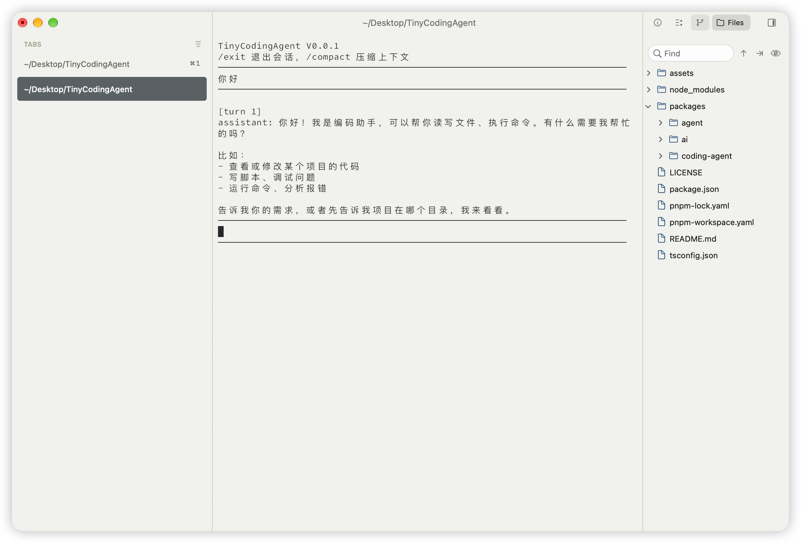

# TinyCodingAgent

这是一个非常简陋的编码Agent，也是我的第一个终端Agent项目（参考[Pi](https://pi.dev/)开发）<br>
它基于TS和Node内置API，没有使用任何第三方运行时依赖（目的是暴露一切细节）<br>
目前它只是一个学习项目，或许能帮你从真实Agent的代码角度理解LoopEngineering（核心代码约100行）




## 快速开始

你可以从npm快速安装它，需要 Node.js 24.10.0 或更高版本。

```bash
// 安装
npm install -g @tinycodingagent/coding-agent
// 更新
npm update -g @tinycodingagent/coding-agent
// 配置
tca config
// 启动
tca
```

配置文件位于 `~/.tinycodingagent/auth.json`，可以运行 `tca config` 设置，也可以手动创建：

```json
{
  "MODEL": "deepseek-flash",
  "API_KEY": "你的 API Key",
  "BASE_URL": "https://api.deepseek.com",
  "CONTEXT_WINDOW": "1000000" //可选，模型最大上下文，为空时不启用上下文自动压缩
}
```

## 技术简介

架构和大量细节参考 [Pi](https://pi.dev/)来做的（也进行了大量简化处理），我认为PI的设计非常之优雅
- `@tinycodingagent/coding-agent` 提供 CLI 和各类工具
- `@tinycodingagent/agent` 实现 Agent 循环与上下文压缩
- `@tinycodingagent/ai` 定义模型接口并提供接口OpenaiAPI兼容器

```text
TinyCodingAgent/
├── packages/
│   ├── coding-agent/
│   │   ├── src/
│   │   │   ├── tools/
│   │   │   ├── cli.ts
│   │   │   └── config.ts
│   │   ├── package.json
│   ├── agent/
│   │   ├── src/
│   │   │   ├── compaction/
│   │   │   ├── index.ts
│   │   │   ├── run-agent.ts
│   │   │   └── types.ts
│   │   ├── package.json
│   └── ai/
│       ├── src/
│       │   ├── providers/
│       │   ├── index.ts
│       │   └── types.ts
│       ├── package.json
```

